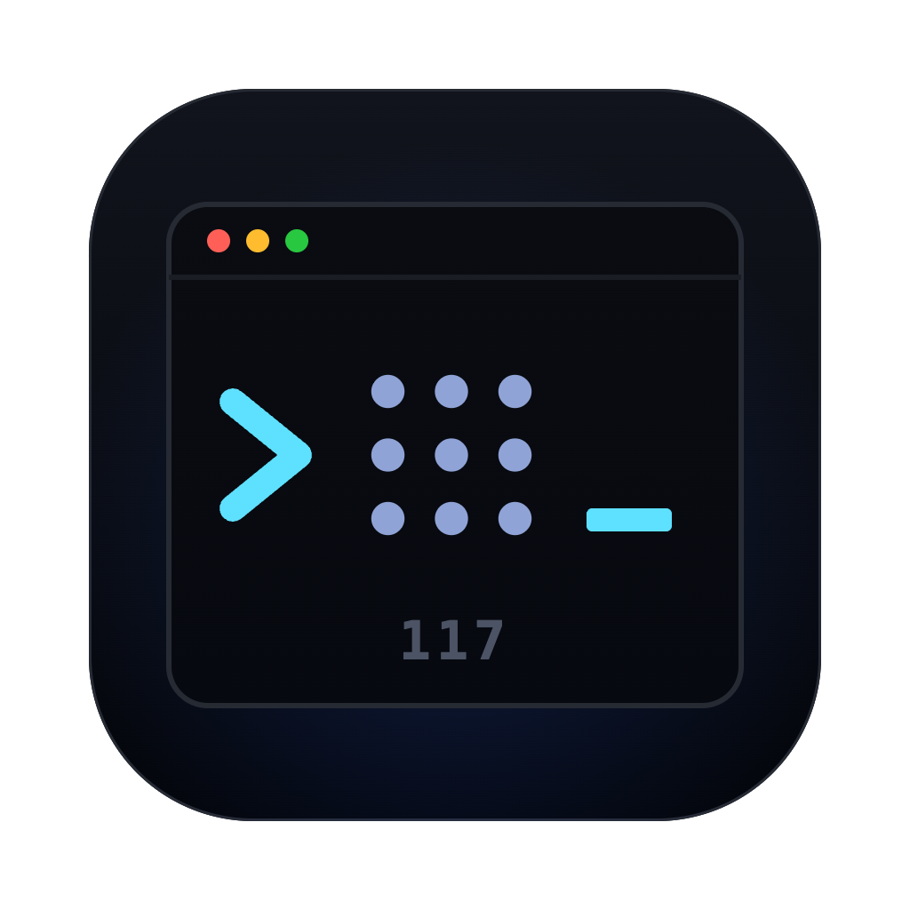
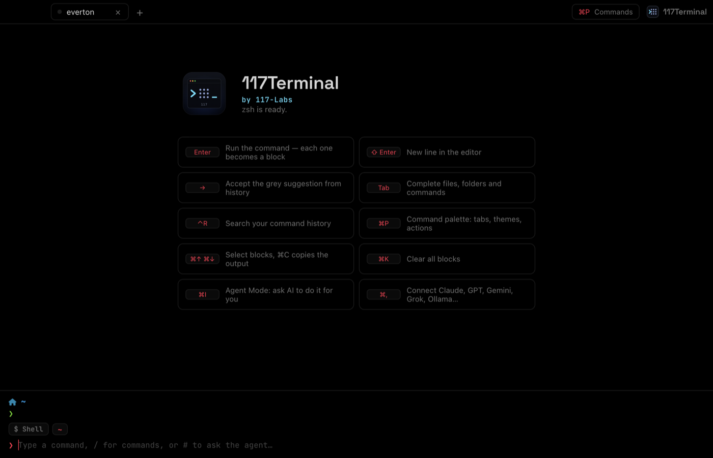
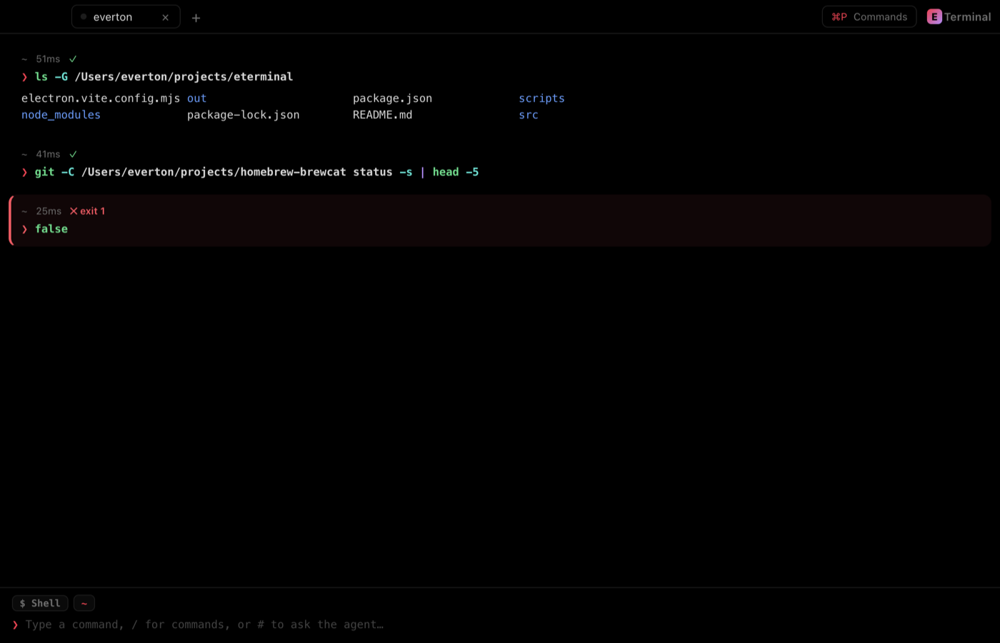
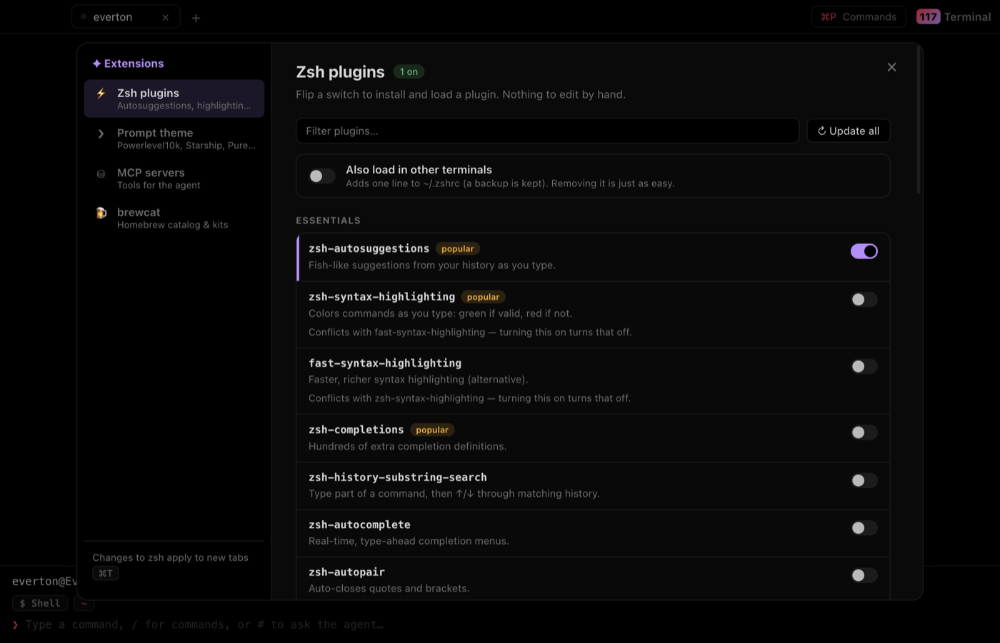
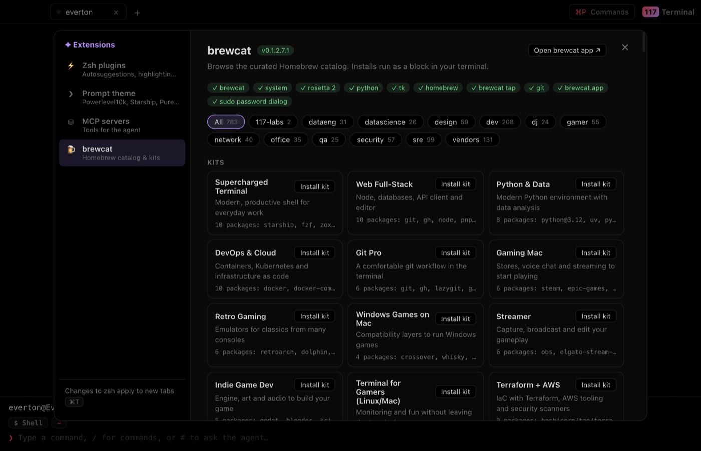
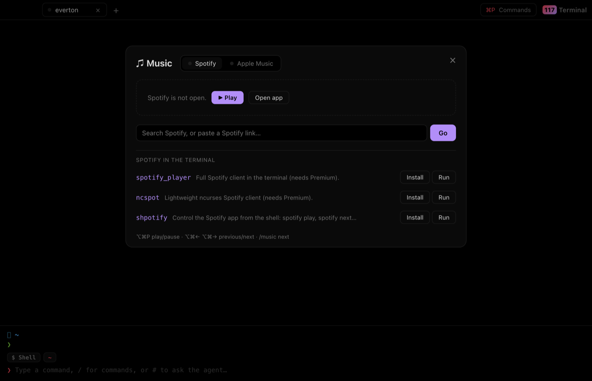
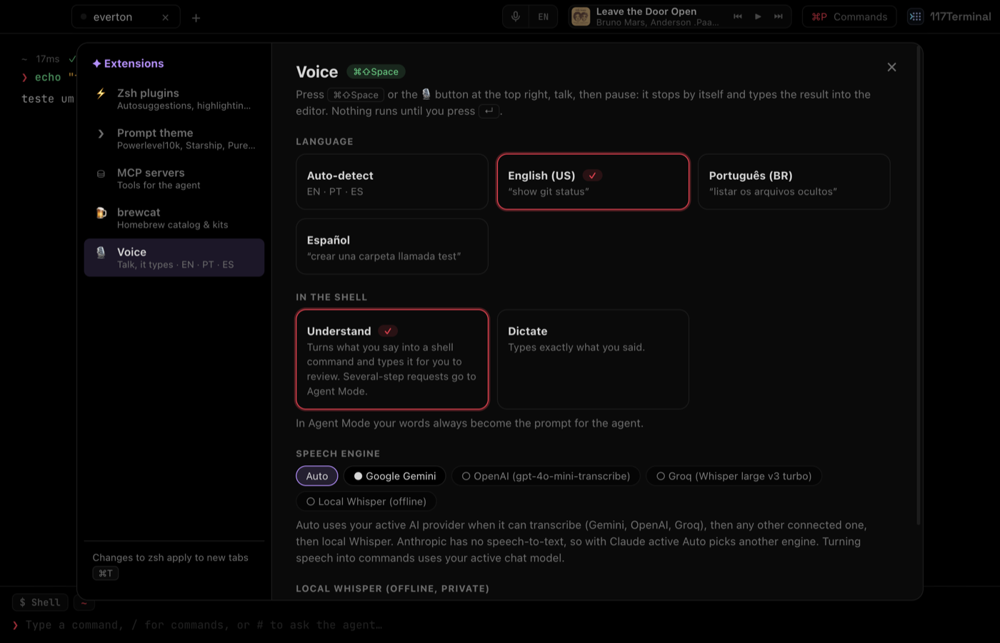
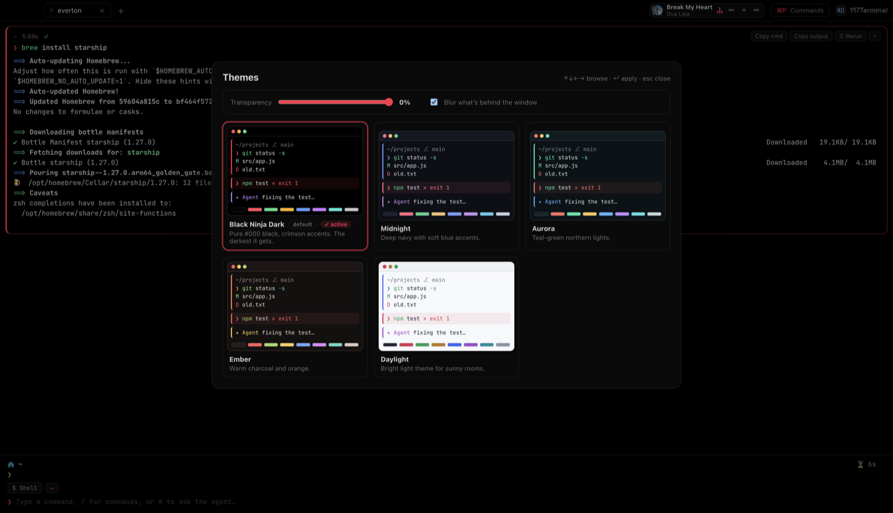

<div align="center">



```
 ██╗ ██╗███████╗████████╗███████╗██████╗ ███╗   ███╗██╗███╗   ██╗ █████╗ ██╗
███║███║╚════██║╚══██╔══╝██╔════╝██╔══██╗████╗ ████║██║████╗  ██║██╔══██╗██║
╚██║╚██║    ██╔╝   ██║   █████╗  ██████╔╝██╔████╔██║██║██╔██╗ ██║███████║██║
 ██║ ██║   ██╔╝    ██║   ██╔══╝  ██╔══██╗██║╚██╔╝██║██║██║╚██╗██║██╔══██║██║
 ██║ ██║   ██║     ██║   ███████╗██║  ██║██║ ╚═╝ ██║██║██║ ╚████║██║  ██║███████╗
 ╚═╝ ╚═╝   ╚═╝     ╚═╝   ╚══════╝╚═╝  ╚═╝╚═╝     ╚═╝╚═╝╚═╝  ╚═══╝╚═╝  ╚═╝╚══════╝
```

**`>_ JACK IN. RUN BLOCKS. LET THE AGENT WORK THE GRID.`**

<sub><code>// a block-based terminal for netrunners · forged by 117-Labs · React + Electron · macOS · Windows · Linux</code></sub>

<br />

[](#-cat-devintro)
[](#-tree--l-2-src)
[](#-man-agent--the-ghost-in-your-shell)
[](LICENSE)

</div>

```text
[ 0.000] 117TERMINAL BIOS v0.1.3 ............................ OK
[ 0.012] pty bridge (node-pty) ............................. OK
[ 0.031] shell integration (OSC 6973 markers) .............. OK
[ 0.044] xterm.js parser ................................... OK
[ 0.058] agent uplink: claude · gpt · gemini · grok · ollama  STANDBY
[ 0.071] mcp bus ........................................... STANDBY
[ 0.076] voice link: en-US · pt-BR · es ..................... ARMED
[ 0.080] theme: BLACK NINJA DARK (#000000) ................. LOADED
[ 0.093] >>> welcome back, runner.
```

---

## `$ cat /dev/intro`

The city never sleeps and neither does your shell. **117Terminal** splits the endless scroll into **blocks**: every
command gets its own capsule with cwd, git branch, runtime and exit code. Failures glow red. Then type `#` and hand the
grid to an **AI agent** that proposes commands, waits for your go, runs them as real blocks and reads the output back.

Or just **talk to it** — in English, Português or Español — and it types the command for you. It speaks **your** zsh: your `.zshrc`, your aliases, Powerlevel10k, plugins installed with one switch. All wrapped in pure
`#000` black with crimson neon.

<div align="center">

</div>

---

## `$ ls ./features`

| ⚡ module | what it does |
|---|---|
| **`blocks`** | Each command is a block: copy command/output, rerun, collapse. `⌘↑ ⌘↓` to select, `⌘C` copies the output. |
| **`real_pty`** | Your actual zsh or bash through `node-pty`. A tiny shim emits private OSC markers so the UI knows where each command starts and ends. |
| **`xterm_core`** | Output is parsed by xterm.js: ANSI colors, `\r` progress bars and cursor moves render right. `vim`, `less`, `htop` jump to a full-screen view. |
| **`interactive`** | Any running command can open in a raw terminal (`⤢ Interactive`). `ssh` and `p10k configure` go there automatically. |
| **`editor`** | Syntax highlighting, multi-line (`⇧↵`), ghost suggestions from history (`→`), `Tab` completion, `⌃R` history search. |
| **`agent_mode`** | `⌘I` or a leading `#`. The agent plans, you approve every command (or let read-only ones run on their own). |
| **`mcp_bus`** | MCP servers become agent tools. Presets, custom servers, one-click import from Claude Code, Claude Desktop, Kiro, VS Code, Cursor. |
| **`zsh_mods`** | 25+ plugins and tools behind a switch: autosuggestions, syntax highlighting, fzf-tab, zsh-z, Oh My Zsh git/docker/kubectl, zoxide, atuin, mise… |
| **`prompt_skins`** | Powerlevel10k (lean, classic, rainbow, pure…), Starship presets, Pure, Spaceship. Your PS1 can render above the editor. |
| **`brewcat`** | The [brewcat](https://github.com/1985epma/homebrew-brewcat) Homebrew catalog built in: profiles, search, kits, doctor. Installs run as blocks. |
| **`voice_link`** | `⌘⇧Space` or the 🎙 top-right: talk in **English, Português or Español**, it types the command for you to review (*"listar os arquivos ocultos"* → `ls -d .*`). Gemini, OpenAI, Groq or offline whisper.cpp. |
| **`audio_deck`** | Spotify and Apple Music in the tab bar: now playing, artwork, seek, volume, shuffle, library search, Spotify links. |
| **`skins`** | Black Ninja Dark (default), Midnight, Aurora, Ember, Daylight. Window transparency and blur. |
| **`slash`** | Type `/` for the command menu. |

<div align="center">

<br /><sub><code>// one command, one capsule. red border = non-zero exit.</code></sub>
</div>

---

## `$ man agent` — the ghost in your shell

```text
┌───────────────────────────────────────────────────────────────┐
│ YOU   ▸ how many files are in this folder? use a command       │
│ AGENT ▸ I'll count the regular files.                          │
│         ⌘ find . -maxdepth 1 -type f | wc -l    [↵ run] [esc]  │
│ $ find . -maxdepth 1 -type f | wc -l                        ✓  │
│ 8                                                              │
│ AGENT ▸ There are 8 regular files in the current directory.    │
└───────────────────────────────────────────────────────────────┘
```

**Connect any brain** in **Settings › AI Agent** (`⌘,` or `/model`). Paste a key, hit **Connect & use**, and the model list loads itself.

| provider | wire | notes |
|---|---|---|
| Anthropic Claude | official SDK | defaults to `claude-opus-5-5` |
| OpenAI | OpenAI API | |
| Google Gemini | OpenAI-compatible endpoint | defaults to the latest Flash |
| xAI Grok | OpenAI-compatible | |
| Ollama · LM Studio | local, no key | pick a model with tool support |
| OpenRouter · Groq · DeepSeek · Mistral · custom | OpenAI-compatible | any `/v1/chat/completions` server |

> 🔐 **Keys never touch the UI.** They live in the main process, encrypted at rest (AES-256-GCM with a per-user key
> file; the macOS Keychain is optional in Settings › AI Agent).
> Keys in `ANTHROPIC_API_KEY`, `OPENAI_API_KEY`, `GEMINI_API_KEY`, `XAI_API_KEY`… are picked up automatically.

Every command the agent wants to run shows up as a card: **`↵` run · `esc` skip · edit before running**. You can let it
auto-run read-only commands (`ls`, `cat`, `git status`…). MCP tool calls get the same approval card, unless you mark the
server as trusted.

---

## `$ ./extensions --all` &nbsp;<sub>`⌘,` · `⌘⇧X`</sub>

Everything lives in one **Settings** panel (`⌘,`, the app menu, or `/settings`): General · Appearance · AI Agent ·
Voice · MCP servers · Zsh & Prompt · Integrations · Web & HarmonyOS · Shortcuts. The menus and slash commands jump straight
to the right section.

<table>
<tr>
<td width="50%"></td>
<td width="50%"></td>
</tr>
<tr>
<td><sub><code>// zsh plugins: flip a switch, it clones and loads</code></sub></td>
<td><sub><code>// brewcat: profiles, search and one-click kits</code></sub></td>
</tr>
</table>

- **Zsh plugins** live in `~/.117terminal/zsh/` and load from one generated file. **Your `~/.zshrc` is never touched**
  unless you flip *Also load in other terminals* (one line, with a backup).
- **Prompt** themes: Powerlevel10k ships with a preset so its wizard never hijacks your first prompt. Missing icons?
  Install the Nerd Font from the Prompt tab (`brew install --cask font-symbols-only-nerd-font`).
- **MCP servers** live in `~/.117terminal/mcp.json`, in the same `mcpServers` shape as Claude.
- **brewcat** runs `brewcat install "<name>" --yes` as a visible block, so you watch every byte land.

---

## `$ play --deck`

<div align="center">

</div>

Spotify and Apple Music, driven by AppleScript. **No API keys, no login**, and polling never launches an app.
`⌥⌘P` play/pause · `⌥⌘← ⌥⌘→` previous/next · `/music <song>` plays the best match from your Apple Music library ·
`/spotify <link>` plays a Spotify URL. Want it fully in the terminal? Install `spotify_player`, `ncspot` or `shpotify`
from the panel.

---

## `$ talk --voice` &nbsp;<sub>`⌘⇧Space`</sub>

Hit **`⌘⇧Space`** or the 🎙 at the top right, say what you want, pause. 117Terminal stops listening on its own, works
out the command and **types it into the editor** — you review, then `↵`. Nothing runs by itself.

| you say | language | it types |
|---|---|---|
| *"show me the git status"* | 🇺🇸 English (US) | `git status` |
| *"listar todos os arquivos ocultos desta pasta"* | 🇧🇷 Português (BR) | `ls -d .*` |
| *"crear una carpeta llamada pruebas"* | 🇪🇸 Español | `mkdir pruebas` |

<sub><code>// real results from the test run: macOS voices → Gemini Flash → command</code></sub>

- **Languages:** English (US), Português (BR), Español, or auto-detect. The chip next to the mic cycles them.
- **Modes:** *Understand* turns speech into a command (multi-step requests jump to Agent Mode); *Dictate* types
  exactly what you said. In Agent Mode your words become the agent prompt.
- **Engines:** your active AI provider when it can hear (Gemini, OpenAI, Groq), or **local Whisper** (whisper.cpp)
  for fully offline, private voice — one click to install it and download the model.
- **Privacy:** audio is captured only while the mic is red and sent only to the engine you picked.

<div align="center">

</div>

---

## `$ 117terminal --serve` — HarmonyOS & any browser

117Terminal can run **without a window** and serve its full UI — blocks, agent, voice, themes — to any web browser.
That's how it runs on **HarmonyOS** (PC, tablet, phone), iPads, Chromebooks or a second computer.

```bash
117terminal --serve                       # http://127.0.0.1:7117/?token=…  (this machine only)
117terminal --serve --host 0.0.0.0        # reachable from your LAN (HarmonyOS tablet/phone)
117terminal --serve --port 8080 --open    # other port, open the browser for you
```

| where | the command is |
|---|---|
| macOS (Homebrew cask) | `117terminal --serve`, or `/Applications/117Terminal.app/Contents/MacOS/117Terminal --serve` |
| Linux (deb / rpm / brew) | `117terminal --serve` (add `--no-sandbox` for the tar.gz) |
| Windows | `117Terminal.exe --serve` from its install folder (Start menu → 117Terminal → *Open file location*). A Windows GUI app cannot print to the console, so read the link from `%APPDATA%\117Terminal\web.json` |

The URL is the only thing on **stdout** (messages go to stderr), so scripts can do `URL=$(117terminal --serve)`, or
`117terminal --serve --json` for `{"url","port","host"}`. Keep a stable link with `--token-file ~/.config/117terminal/token`
(created `0600` on first use) or the `T117_TOKEN` variable: `--token` works too, but anyone on the machine can read it
in `ps`. While it runs, the link is also in `web.json` in the app's data folder. Port taken → exit code 3.

### `$ 117terminal --help`

```text
117terminal [folder...]             open the app (a new tab per folder)
117terminal run <command>           new tab in this folder, running <command>
117terminal theme <name>            ninja, midnight, aurora, ember, daylight
117terminal serve [--port --host --token-file --open --json]
117terminal doctor [--json]         check libraries, shell, agent and web mode
117terminal completions bash|zsh|fish
117terminal --version · --help
```

From a terminal, the app opens in the background and gives you the prompt back (like `code .`); `--wait` keeps it
attached. With the app already open, `117terminal ~/api` or `117terminal run "npm test"` adds a tab to it. A typo gets a
suggestion (`unknown option: --serv (did you mean --serve?)`). Exit codes: `0` ok · `1` error · `2` wrong usage ·
`3` port in use. Shell completions:

```bash
eval "$(117terminal completions bash)"                                   # ~/.bashrc
117terminal completions zsh > "${fpath[1]}/_117terminal"                 # zsh
117terminal completions fish > ~/.config/fish/completions/117terminal.fish
```

**No command line?** Open **Settings › Web & HarmonyOS** (or *Shell › Open in Browser*) in the desktop app and press
**Start web mode**: it shows the link for this computer and, if you allow other devices, the one for your network.

**On a HarmonyOS PC** (ARM): HarmonyOS apps can't run Electron directly, but HarmonyOS PC ships a Linux environment
(Huawei's *Converged Development Engine*, in preview). Inside it, unpack `117Terminal-X.Y.Z-linux-arm64.tar.gz`, run
`./117terminal --serve --no-sandbox` (no display needed: it goes headless by itself) and open the printed
`http://127.0.0.1:7117/?token=…` in the HarmonyOS browser.

**From a HarmonyOS tablet or phone:** run `117terminal --serve --host 0.0.0.0` on your Mac/PC/Linux box and open
`http://<that-computer's-IP>:7117/?token=…` on the device. The shell, the agent and the music deck run on that computer.

> 🔐 **It's a shell, treat the URL like a password.** The server listens on `127.0.0.1` unless you pass `--host`, every
> request needs the random token (kept in an `HttpOnly` cookie after the first visit), and loopback requests with a
> foreign `Host` header are refused (no DNS rebinding). Only expose it on networks you trust; for anything wider, put
> it behind a VPN or an HTTPS reverse proxy. Closing the browser tab ends its shells.

<sub><code>// tested: desktop and phone-size browsers against a macOS server. HarmonyOS itself is untested (no device here).
Voice in the browser needs a secure context: works on localhost, not over plain-HTTP LAN.</code></sub>

In the browser, `⌘T`/`⌘W` belong to the browser, so tabs use **`⌥T` / `⌥W`**; the other shortcuts work as usual.

---

## `$ /help`

```text
/agent [prompt]    switch to Agent Mode, or ask right away
/new [prompt]      fresh agent conversation
/shell             back to the plain shell
/model             connect or switch the AI provider
/plugins /prompt   zsh plugins · prompt themes
/mcp /brewcat      MCP servers · Homebrew catalog
/music [cmd|song]  play, pause, next, prev, or search
/spotify [link]    /applemusic [search]
/voice             voice: language (EN · PT · ES), engine, mode
/theme             skins, transparency, blur
/settings          every setting in one place
/clear  /stop      clear blocks · stop the agent
```

| keys | action |
|---|---|
| `⌘T` `⌘W` `⌘1…9` | tabs |
| `⌘P` | command palette |
| `⌘I` · `#` | agent mode · ask once |
| `⌘K` | clear blocks |
| `⌃R` | history search |
| `⌘,` | settings (everything) |
| `⌥⌘T` | settings › appearance |
| `⌘⇧X` | settings › zsh & prompt |
| `⌘⇧Space` | talk → it types (voice) |

<div align="center">

<br /><sub><code>// skins with live previews · transparency + blur · now playing in the tab bar</code></sub>
</div>

---

## `$ sudo make install`

**Grab a build** from [Releases](https://github.com/1985epma/117-terminal/releases/latest), or let a package manager do it.
Homebrew needs the [tap](https://github.com/1985epma/homebrew-117terminal) trusted once:

```bash
brew tap 1985epma/117terminal && brew trust 1985epma/117terminal
```

**Linux** — [`install.sh`](install.sh) installs the libraries 117Terminal needs (`libgbm1`, `libasound2`, GTK…) first,
then the right `.deb`/`.rpm` for your CPU, after checking its SHA-256. Download it, read it, run it:

```bash
curl -fsSLO https://raw.githubusercontent.com/1985epma/117-terminal/main/install.sh
less install.sh
bash install.sh            # --user (no sudo), --version X.Y.Z, --dry-run, --uninstall, --help
```

Releases also ship `install.sh` next to the packages, listed in `SHA256SUMS.txt`. If you trust it already, the short form
is `curl -fsSL https://raw.githubusercontent.com/1985epma/117-terminal/main/install.sh | bash`. Running it again with the
same version does nothing (`--force` reinstalls). Tested on Debian 12, Ubuntu 22.04/24.04 and Fedora 41, and in CI on
x86_64 and arm64 after every release.

| system | command |
|---|---|
| 🍎 macOS (Homebrew) | `brew install --cask 1985epma/117terminal/117terminal` |
| 🐧 Linux (Homebrew) | `brew install 1985epma/117terminal/117terminal` |
| 🐧 Debian / Ubuntu | `install.sh` above, or download the `.deb`, then `sudo apt install ./117Terminal-*.deb` |
| 🐧 Fedora / RHEL | `install.sh` above, or download the `.rpm`, then `sudo dnf install ./117Terminal-*.rpm` |
| 🪟 Windows (winget) | `winget install 1985epma.117Terminal` — *[in review](https://github.com/microsoft/winget-pkgs/pull/468426), live once Microsoft approves* |
| 🪟 Windows | download the `.msi` and run it (uses PowerShell; `pwsh` if installed) |

### `$ ls ./releases/latest`

Every tag `vX.Y.Z` is built on GitHub Actions (macOS, Windows, Ubuntu) and published with a `SHA256SUMS.txt`:

| file | for |
|---|---|
| `117Terminal-X.Y.Z-mac-arm64.dmg` / `.zip` | macOS, Apple Silicon |
| `117Terminal-X.Y.Z-mac-x64.dmg` / `.zip` | macOS, Intel |
| `117Terminal-X.Y.Z-win-x64.msi` | Windows 10/11 x64 |
| `117Terminal-X.Y.Z-linux-amd64.deb` | Debian, Ubuntu |
| `117Terminal-X.Y.Z-linux-x86_64.rpm` | Fedora, RHEL, openSUSE |
| `117Terminal-X.Y.Z-linux-x64.tar.gz` | any Linux x64 (portable) |
| `117Terminal-X.Y.Z-linux-arm64.deb` · `-linux-aarch64.rpm` · `-linux-arm64.tar.gz` | Linux ARM64 (HarmonyOS PC Linux env, Raspberry Pi, ARM servers) |

```bash
sha256sum -c SHA256SUMS.txt --ignore-missing   # verify what you downloaded
```

> 🛡️ **Builds aren't notarized/signed by a paid certificate yet.** The Homebrew cask clears macOS quarantine for you. With
> the raw `.dmg`, right-click → *Open* the first time. On Windows, SmartScreen may ask: *More info → Run anyway*.

**Or build from source:**

```bash
git clone https://github.com/1985epma/117-terminal.git
cd 117-terminal
npm install
npm run build && npm start
```

> ⚠️ **Newer npm blocks install scripts.** If `npm install` warns about `node-pty` or `electron`, run
> `node node_modules/electron/install.js && npm run rebuild` once. `node-pty` compiles natively, so you need the Xcode
> Command Line Tools (`xcode-select --install`).

| command | does |
|---|---|
| `npm run dev` | hot-reload dev mode |
| `npm run build && npm start` | production build |
| `npm run dist:mac` · `dist:win` · `dist:linux` | package for one OS into `dist/` |

**Cutting a release:** bump `version` in `package.json`, commit, then `git tag -a vX.Y.Z -m "117Terminal X.Y.Z" && git push
origin vX.Y.Z`. The tag must match the version (the workflow checks). Then update the Homebrew tap with
`scripts/bump.sh X.Y.Z` in [homebrew-117terminal](https://github.com/1985epma/homebrew-117terminal) and the winget manifest.
See [CHANGELOG.md](CHANGELOG.md).

**Runs on:**

| platform | status | shells with blocks |
|---|---|---|
| macOS 13+ (Apple Silicon, Intel) | 🟢 main platform, tested | zsh, bash, fish |
| Linux x64 / arm64 (glibc ≈ Ubuntu 22.04 / Debian 12+) | 🟡 built and packaged in CI | zsh, bash, fish |
| HarmonyOS · iPadOS · ChromeOS · any browser | 🟡 via `117terminal --serve` (web UI) | the server's shell |
| Windows 10/11 x64 | 🟡 built in CI, block integration untested on real hardware | PowerShell (`pwsh` preferred) |

The music deck is macOS-only. Everything else (blocks, agent, MCP, themes) is cross-platform.

---

## `$ tree -L 2 ./src`

```text
src/
├── main/                    # the backend: Electron main process
│   ├── index.js             # window, menu, PTYs, completion, history
│   ├── shell-integration.js # zsh/bash/fish/PowerShell shims → OSC 6973 markers
│   ├── ai.js                # providers, Keychain keys, streaming tool calls
│   ├── mcp.js               # MCP client: presets, imports, tool calls
│   ├── zsh-plugins.js       # plugin & prompt catalog → plugins.zsh
│   ├── brewcat.js           # brewcat CLI bridge (--json)
│   ├── music.js             # Spotify + Apple Music via AppleScript
│   ├── migrate.js           # one-time move from the old ETerm identity
│   ├── ipc.js · core.js     # one IPC registry + PTY core, shared by window and web
│   └── web-server.js        # --serve: HTTP + WebSocket, token auth
├── shared/eterm-api.js      # window.eterm, built from any transport (IPC or WebSocket)
├── preload/                 # the only door between UI and system
.github/workflows/           # ci.yml (build on push) · release.yml (packages on tag)
scripts/                     # adhoc-sign.cjs (macOS) · brand-dev.mjs
└── renderer/src/            # React UI
    ├── lib/session.js       # PTY stream → blocks, PS1 capture
    ├── lib/agent.js         # plan → approve → run → read → repeat
    └── components/          # blocks, editor, agent, extensions, music
```

```text
 keystroke ─▶ editor ─▶ pty ─▶ zsh ──┬─▶ OSC 6973;C          (command starts)
                                     ├─▶ output ─▶ xterm.js ─▶ block
                                     └─▶ OSC 6973;D;<exit>   (block sealed)
```

---

## `$ whoami`

<div align="center">


**117Terminal** · forged by **[117-Labs](https://github.com/1985epma)** · built with 117-labs

Styled after the 117-Labs design system: `#03050a` void, `#8fa3d6` mark, `#5ee0ff` signal,
Space Grotesk + JetBrains Mono.

| brand asset | file |
|---|---|
| app icon (source) | [`build/icon.svg`](build/icon.svg) → `icon.png` · `icon.icns` |
| link preview (1280×640) | [`docs/social-preview.png`](docs/social-preview.png) — set in *Settings → Social preview* |
| screenshots | [`docs/screenshots/`](docs/screenshots) |

<sub><code>EOF // MIT licensed · stay dark, stay curious</code></sub>

</div>
